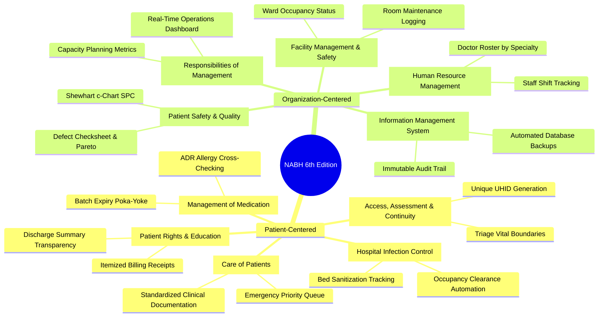

# Comprehensive Literature Review & Industry Benchmarking
**Course:** BBAT104 — Fundamentals of Total Quality Management  
**Project:** Hospital Management System (HMS) — TQM-Driven Healthcare Informatics  
**Student:** Ajay Bora | **Roll No:** 2410302008 | **Branch:** CSE — Section B  
**Academic Session:** 2026–27  
**Official Guideline Identifier:** `BBAT104_TQM_2410302008`  

---

## 1. Executive Summary & Purpose of Literature Review

Healthcare Information Systems (HIS) and Electronic Medical Records (EMR) are mission-critical socio-technical infrastructures where software failures directly translate into clinical morbidity, diagnostic delays, medication misadventures, and patient dissatisfaction. The primary objective of this literature review is to ground the software engineering and Total Quality Management (TQM) design of our **Hospital Management System (HMS)** in empirical healthcare operations, national digital health architectures, and statutory quality standards.

Rather than developing features based on anecdotal assumptions or producing a superficial CRUD database, this study systematically analyzes:
1. **Hospital Quality & Accreditation Standards:** National Accreditation Board for Hospitals & Healthcare Providers (NABH 6th Edition, January 2025).
2. **National Digital Health Ecosystem:** Ayushman Bharat Digital Mission (ABDM), Ayushman Bharat Health Account (ABHA), and Fast Healthcare Interoperability Resources (FHIR).
3. **Clinical Process Workflows:** Outpatient Department (OPD) patient journeys, hand-off failures, and clinical bottlenecks.
4. **Software & Quality Engineering Benchmarks:** Mistake-proofing (Poka-Yoke), Failure Mode & Effects Analysis (FMEA), Statistical Process Control (SPC), and Deming's Plan-Do-Check-Act (PDCA) cycle.
5. **Existing Industry HIS Products:** Comparative analysis of enterprise hospital systems, commercial clinic software, and clinician-built digital hospitals.

---

## 2. Core Literature Review Buckets

| # | Literature Area | Primary Standard / Academic Sources Studied | Key Takeaways & Testable Requirements Extracted |
|---|---|---|---|
| **1** | **Hospital Quality** | NABH Hospital Accreditation Programme (6th Edition, Jan 2025); Quality Council of India (QCI). | Patient identification protocols, prescription legibility, medication allergy cross-checks, laboratory critical limit alerts, and immutable medical audit trails. |
| **2** | **Digital HIS / EMR** | HIMSS Electronic Medical Record Adoption Model (EMRAM Stages 1–7); ISO/TS 18308: Health Informatics. | Transition from isolated departmental silos to integrated Patient 360° longitudinal health records with transactional atomicity. |
| **3** | **Indian Digital Health** | National Health Authority (NHA) ABDM Sandbox; ABHA Specification v2.0; Unified Health Interface (UHI). | Architectural separation between institutional permanent identifier (UHID) and national health identity (ABHA); consent-driven, federated data access. |
| **4** | **Clinical Workflow** | Institute of Medicine (IOM) "To Err Is Human"; Lean Healthcare (Muda, Muri, Mura); OPD Time-Motion Studies. | Queue management, triage prioritization (Code Red/Yellow/Green), doctor consultation cycle time, and diagnostic turn-around time (TAT). |
| **5** | **Software Engineering** | IEEE 830 / ISO/IEC/IEEE 29148 (Requirements Engineering); Martin Fowler (Layered Architecture); Role-Based Access Control (NIST RBAC). | Strict multi-tier separation (Presentation → REST API → Service/Business Rules → Data Access/Models → SQLite Database); server-side authorization enforcement. |
| **6** | **Quality Engineering** | Shigeo Shingo (Poka-Yoke Mistake-Proofing); AIAG & VDA FMEA Handbook; Walter Shewhart & W. Edwards Deming (SPC & PDCA). | Keystroke input masking, categorical dropdowns, schedule conflict pre-flight checks, batch expiry blocks, and Shewhart c-chart statistical process monitoring. |
| **7** | **Security & Privacy** | Digital Personal Data Protection Act (DPDP 2023, India); ISO/IEC 27001; DISHA (Digital Information Security in Healthcare Act). | Cryptographic password hashing (SHA-256), session timeouts, role-segregated API endpoints, zero-plaintext credential persistence, and synthetic evaluation data. |

---

## 3. NABH 6th Edition Accreditation Standards Analysis

The National Accreditation Board for Hospitals & Healthcare Providers (NABH 6th Edition, January 2025) organizes hospital operational quality into **10 core chapters**, divided into Patient-Centered and Organization-Centered standards. Our system architecture directly translates these regulatory expectations into testable software controls:



### 3.1 Detailed Mapping of NABH Chapters to Implemented Software Modules

| NABH Chapter | Regulatory Objective | Healthcare Risk Addressed | Implemented Software Feature in HMS | Verification / Automated Test |
|---|---|---|---|---|
| **AAC** — Access, Assessment & Continuity | Standardized patient identification and continuous clinical tracking across episodes. | Duplicate records, lost historical charts, unrecognized emergency deterioration. | `UHID-2026-XXXXX` permanent internal identifier; Patient 360° longitudinal journey; Triage vital sign scoring. | `test_patient_timeline.py`, `test_patient_boundaries.py` |
| **COP** — Care of Patients | Uniform clinical care, clinical decision support, and timely intervention. | Inconsistent documentation, mismanaged emergency queue. | Automated emergency priority queue (Code Red/Yellow/Green); Structured clinical consultation notes. | `test_triage_queue.py`, `test_triage_boundaries.py` |
| **MOM** — Management of Medication | Safe prescription, dispensing, batch control, and adverse event prevention. | Dispensing expired pharmaceuticals; Fatal Adverse Drug Reactions (ADR). | Pre-flight drug allergy contraindication matrix (`config.DRUG_CONTRAINDICATION_MAP`); Expiry date validation (`models/medicine.py`). | `test_clinical_poka_yoke.py`, `test_pharmacy_expiry.py` |
| **PRE** — Patient Rights & Education | Billing transparency, informed consent, and accessible medical records. | Surprise charges, unclear treatment directions, illegible billing receipts. | Printable HTML receipts with itemized breakdown; Discharge summary advice documentation. | `test_billing_validation.py`, `test_report_generator.py` |
| **HIC / IPC** — Infection Control | Safe patient placement, bed sanitization, and environmental hygiene. | Cross-contamination from reusing unsanitized ward beds. | Automated bed release state machine (`Occupied` → `Cleaning / Sanitizing` → `Available`). | `test_admission_boundaries.py`, `test_room_boundaries.py` |
| **PSQ** — Patient Safety & Quality Improvement | Continuous data-driven monitoring of clinical and administrative defects. | Recurrent data entry errors; Lack of root-cause corrective actions. | Real-time defect checksheet (`TQM/data/checksheet.csv`); Pareto 80/20 analysis; Shewhart SPC c-chart (`sqc/spc_chart.py`). | `test_spc_chart.py`, `test_six_sigma.py`, `test_spc_resilience.py` |
| **ROM** — Responsibilities of Management | Strategic resource allocation, department oversight, and governance. | Administrative blind spots regarding bed shortages and revenue leakages. | Executive dashboard with real-time room occupancy, unpaid invoices, daily patient footfall, and Six Sigma DPMO. | `test_web_app.py`, `test_api_error_handling.py` |
| **FMS** — Facility Management & Safety | Ward, equipment, and room readiness maintenance. | Double-booking hospital beds; Neglected broken room facilities. | Unique room constraints; Maintenance status tracking (`Under Maintenance`, `Blocked`). | `test_room_boundaries.py` |
| **HRM** — Human Resource Management | Authorized staffing, role clarity, and duty scheduling. | Unqualified staff performing clinical actions; Conflicting doctor shifts. | Multi-shift staff management; Specialty-indexed doctor directory; Server-side RBAC. | `test_staff_doctor_boundaries.py`, `test_login_dialog.py` |
| **IMS** — Information Management System | Data confidentiality, integrity, availability, auditability, and business continuity. | Silent data tampering; System crashes causing unrecoverable data loss. | Dual-tier atomic audit logs (`audit_log` table + CSV mirror); Automated SQLite database snapshot backups. | `test_audit_sync.py`, `test_db.py` |

---

## 4. ABDM and Indian Digital Health Architecture

The Ayushman Bharat Digital Mission (ABDM), spearheaded by the National Health Authority (NHA), establishes an open, interoperable digital health infrastructure for India. A modern Indian HIS cannot be architected as an isolated proprietary silo.

### 4.1 Critical Identifier Disambiguation

A common flaw observed in undergraduate HMS projects is treating government identity cards (such as Aadhaar) as the internal database primary key. Our architecture adheres strictly to ABDM architectural standards:

```text
┌─────────────────────────────────────────────────────────────────────────────┐
│                       PATIENT IDENTIFICATION HIERARCHY                      │
└─────────────────────────────────────────────────────────────────────────────┘
                                       │
     ┌─────────────────────────────────┴─────────────────────────────────┐
     ▼                                                                   ▼
[ Internal Institutional Tier ]                         [ National Interoperable Tier ]
  UHID (Unique Hospital Identifier)                       ABHA (Ayushman Bharat Health Account)
  Format: UHID-2026-00042                                 Format: 14-Digit / ABHA Address
  • Primary internal key for records                      • Citizen-controlled health ID
  • Scope: Single Hospital Entity                         • Scope: Nationwide interoperability
  • Owned & governed by HMS database                      • Governed by National Health Authority
                                       │
     ┌─────────────────────────────────┴─────────────────────────────────┐
     ▼                                                                   ▼
[ Financial / Encounter Tier ]                          [ Statutory KYC Tier ]
  Encounter / Episode ID                                  Aadhaar / Voter ID / Passport
  Format: ENC-2026-0108                                   • Identity verification only at intake
  • Distinct visit/stay instance                          • NEVER used as database primary key
  • Links Vitals, Orders, Bills                           • NEVER persisted in plaintext (DPDP 2023)
```

1. **UHID (Unique Hospital Identifier):** The internal, permanent record locator generated sequentially by the hospital (e.g., `UHID-2026-00042`). All longitudinal encounters, lab orders, prescriptions, and bills within this hospital bind to this identifier.
2. **ABHA (Ayushman Bharat Health Account):** A 14-digit national digital health ID and handle (e.g., `ajay.bora@abdm`) enabling citizen-consented health data exchange across clinics nationwide via Health Information Exchanges (HIE-CM).
3. **Government KYC Document (Aadhaar / Driving License):** Used strictly at reception for physical identity verification. In compliance with the **Digital Personal Data Protection Act (DPDP 2023)**, national identity numbers are never used as relational foreign keys or stored in unencrypted tables.
4. **Encounter / Episode ID:** Each clinical visit represents a discrete episodic transaction tied to the patient's master UHID, preserving historical integrity across years of care.

---

