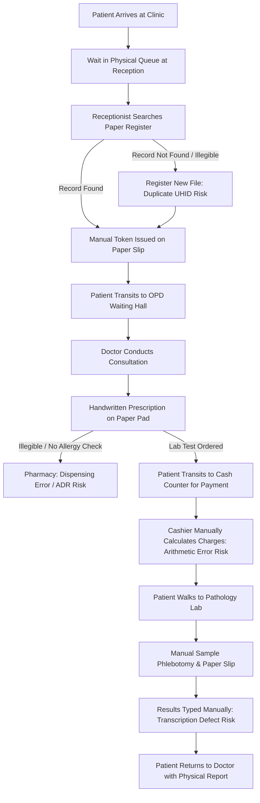
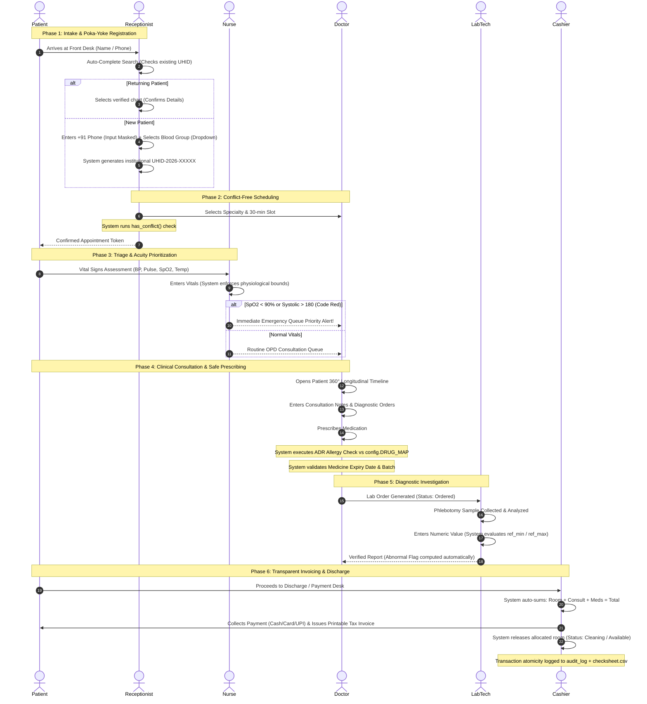
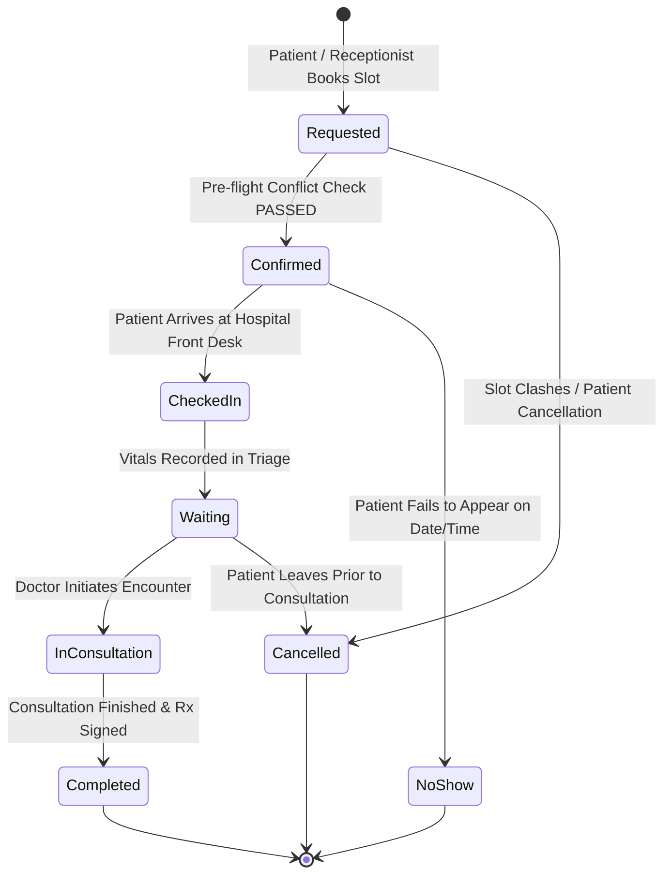
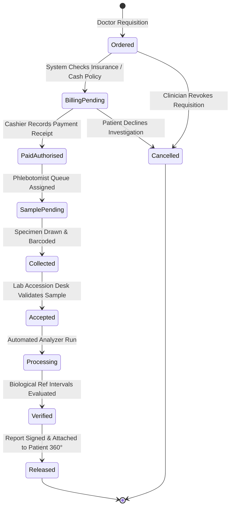

# Process & Workflow Engineering: As-Is vs. To-Be Analysis
**Course:** BBAT104 — Fundamentals of Total Quality Management  
**Project:** Hospital Management System (HMS) — TQM-Driven Healthcare Informatics  
**Student:** Ajay Bora | **Roll No:** 2410302008 | **Branch:** CSE — Section B  
**Academic Session:** 2026–27  
**Official Guideline Identifier:** `BBAT104_TQM_2410302008`  

---

## 1. Executive Summary & Lean TQM Principles

In hospital operations, quality is defined not merely by clinical outcomes, but by the reliability, safety, and timeliness of the underlying administrative and clinical workflows. According to Lean Healthcare principles (Womack et al., 2005) and Total Quality Management (TQM), systemic inefficiencies stem from three core failure categories:
1. **Muda (Waste):** Unnecessary patient waiting, duplicate data entry across paper registers, physical transit of paper slips, and re-collecting demographic data.
2. **Muri (Overburden):** Overloaded doctors deciphering illegible handwriting without historical allergy context; receptionists managing chaotic physical queues.
3. **Mura (Unevenness):** Erratic patient queue distribution, unmanaged walk-in spikes, and volatile doctor scheduling collisions.

In accordance with **Section 10 of the Base Project Guideline**, this document maps:
- The **As-Is Workflow** of a conventional outpatient clinic and its points of failure.
- The **To-Be Workflow** engineered for our TQM Hospital Management System.
- A **Comprehensive Multi-Role Swimlane Process Diagram**.
- Formal **State Transition Machines** for Appointments, Laboratory Investigations, and Ward Bed Allocations.

---

## 2. As-Is Process Analysis & Failure Points

### 2.1 Critical Pain Points in the As-Is Workflow

| Process Step | Operational Waste (Muda) | Failure Mode & Clinical Risk | Root Cause in Legacy Workflow | TQM Poka-Yoke Solution in HMS |
|---|---|---|---|---|
| **Intake / Registration** | 15–20 min queue waiting; Repeated questioning of demographics. | Duplicate patient charts created; Fragmented medical history. | Free-text manual registers with zero search or indexing. | **Debounced Auto-Complete Search + Mandatory Input Masking (`+91-XXXXX-XXXXX`).** |
| **Doctor Scheduling** | Patients arriving when doctor is off-duty; Waiting room crowding. | Double-booking chaos; Excessive patient dissatisfaction. | Paper diaries and verbal doctor schedule handoffs. | **Automated Slot Engine (`has_conflict`) with HTTP 409 conflict blocking.** |
| **Emergency Triage** | Acutely ill patients waiting behind non-urgent routine consultations. | Delayed resuscitation in Code Red emergencies; Clinical morbidity. | First-come, first-served queueing without vital triage. | **Bounded Vital Signs Input + Real-Time Acuity-Sorted Emergency Queue.** |
| **Prescription Writing** | Pharmacists spending time phoning doctors to clarify dosage. | Fatal Adverse Drug Reactions (ADR); Expired drug dispensing. | Handwritten slips; No automated drug-allergy cross-referencing. | **Pre-flight Allergy Contraindication Checker + Batch Expiry Poka-Yoke.** |
| **Diagnostic Requisitions** | Patient walking between billing, lab, and doctor with paper slips. | Unpaid tests processed; Delayed critical lab reports. | Disconnected departmental ledgers with no shared state. | **Reference Range Poka-Yoke + Automated Abnormal Flag ($0$ or $1$) generation.** |
| **Financial Invoicing** | Patients disputing manual additions at discharge. | Revenue leakage; Overcharging or undercharging patients. | Manual arithmetic calculation on paper receipts. | **Automated Server-Side Charge Arithmetic + Instant HTML Print Receipts.** |

---

## 3. To-Be Process Workflow: Multi-Role Swimlane Architecture

The To-Be workflow coordinates **six operational roles** across a synchronized, digital state machine:

---

## 4. Formal State Transition Machines

Every critical hospital entity is governed by a finite state machine with strict transition guards, role authorizations, and audit timestamps.

### 4.1 Appointment State Lifecycle

- **Transition Rules & Guards:**
  - `Confirmed`: Requires `has_conflict() == False` across doctor schedule.
  - `Checked-in`: Generates queue token and records timestamp in `appointments`.
  - `In consultation`: Updates appointment status and opens Patient 360° chart.
  - `Completed`: Automatically triggers billing requisition and writes audit entry.

---

### 4.2 Diagnostic Laboratory Test Lifecycle

- **Transition Rules & Guards:**
  - `Verified`: System executes mathematical range comparison:
    $$\text{abnormal\_flag} = \begin{cases} 1 & \text{if } \text{result\_value} < \text{ref\_min} \text{ or } \text{result\_value} > \text{ref\_max} \\ 0 & \text{otherwise} \end{cases}$$
  - `Released`: Instantly displays abnormal badges (Red Flag) in doctor portal.

---

