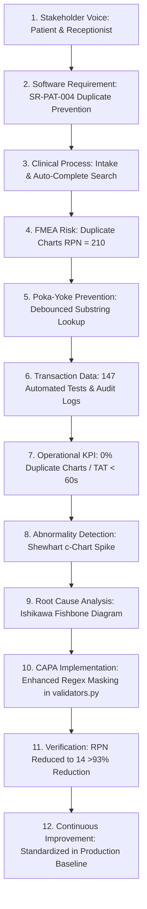

# Project Evaluation & Defense Dossier (Review-1 & Review-2)
**Course:** BBAT104 — Fundamentals of Total Quality Management  
**Project:** Hospital Management System (HMS) — TQM-Driven Healthcare Informatics  
**Student:** Ajay Bora | **Roll No:** 2410302008 | **Branch:** CSE — Section B  
**Academic Session:** 2026–27  
**Official Guideline Identifier:** `BBAT104_TQM_2410302008`  

---

## 1. Executive Purpose

This document serves as the master defense and evaluation dossier for **Review-1** (System Design & Requirements Engineering) and **Review-2** (Software Demonstration & Quality Evidence) in strict alignment with **Sections 20, 21, and 25 of the Base Project Guideline**.

The objective is to equip the student with an airtight presentation script, live demonstration steps, and verifiable evidence proving that this project is not a generic CRUD database, but a disciplined, TQM-engineered healthcare informatics system.

---

## 2. Review-1 Evaluation Dossier: System Design & Requirements

### 2.1 Review-1 Deliverables Checklist

| Guideline Requirement (Section 20) | Implementation Evidence in Repository | Document / Source Reference | Status |
|---|---|---|:---:|
| **Specific Hospital Process & Problem Statement** | Outpatient Department (OPD) & Emergency Triage Journey; Elimination of duplicate records, double-booking, and medication errors. | `docs/LITERATURE_REVIEW.md` (Sec 6) | **READY** |
| **Literature Review** | NABH 6th Edition (all 10 chapters analyzed) + ABDM national digital health framework + 3 system benchmarks. | `docs/LITERATURE_REVIEW.md` (Sec 2–5) | **READY** |
| **Stakeholder Map & Needs** | 10 hospital roles analyzed with explicit information needs, interaction touchpoints, and KPIs. | `docs/STAKEHOLDER_SRS_TRACEABILITY.md` (Sec 2) | **READY** |
| **Numbered, Testable SRS** | 24 atomic specifications (`SR-PAT-001` through `SR-SEC-003`) categorized by clinical domains. | `docs/STAKEHOLDER_SRS_TRACEABILITY.md` (Sec 3) | **READY** |
| **Traceability Matrix** | 6-way matrix linking Stakeholder $\leftrightarrow$ SRS $\leftrightarrow$ Process $\leftrightarrow$ Schema $\leftrightarrow$ UI $\leftrightarrow$ Test. | `docs/STAKEHOLDER_SRS_TRACEABILITY.md` (Sec 4) | **READY** |
| **Process Maps (As-Is / To-Be)** | Waste/delay analysis; multi-role swimlane sequence; finite state machines for Appointments, Lab, Beds. | `docs/PROCESS_WORKFLOW_MAPS.md` | **READY** |
| **Role-Permission Matrix** | Server-side enforced matrix for Admin, Doctor, Receptionist, Nurse, Lab Tech, Cashier. | `docs/architecture.md` (Sec 5) | **READY** |
| **Initial ERD & Data Dictionary** | 14 relational tables with primary keys, foreign keys, constraints, and audit entities. | `docs/ER_Diagram.md`, `src/database/db_manager.py` | **READY** |
| **Layered Architecture Rationale** | Strict multi-tier separation (Presentation $\rightarrow$ REST Blueprints $\rightarrow$ Business Rules $\rightarrow$ SQL Models $\rightarrow$ DB). | `docs/architecture.md` | **READY** |
| **FMEA Risk Prioritization** | 12 failure modes evaluated with Pre/Post RPN calculations demonstrating >90% risk reduction. | `TQM/FMEA.md`, `docs/FMEA_RiskAudit.xlsx` | **READY** |
| **P0 / P1 / P2 Prioritization** | Coherent scope boundaries: P0 Core Intake, P1 Connected Clinical Care, P2 TQM Analytics. | `docs/SRS.md`, `docs/STAKEHOLDER_SRS_TRACEABILITY.md` | **READY** |

---

## 3. Review-2 Evaluation Dossier: Software Demonstration & Quality Evidence

Review-2 evaluates whether the implemented software executes the designed requirements reliably and demonstrates measurable quality improvement.

### 3.1 Live Demonstration Script (Step-by-Step)

The demonstration follows a coherent, end-to-end patient journey:

```text
[Step 1: Poka-Yoke Intake] ──> [Step 2: Emergency Triage] ──> [Step 3: Conflict-Free Slot]
                                                                        │
[Step 6: Real-Time SPC]   <── [Step 5: Itemized Bill]    <── [Step 4: Safe Prescribing]
```

#### Step 1: Patient Intake & Poka-Yoke Registration
- **Action:** Open Desktop GUI (`python run.py`) or Web Portal (`python run.py --web` at `http://127.0.0.1:5000`).
- **Demonstrate:**
  1. Begin typing an existing patient name ("Rohan") in the Auto-Complete field; show existing chart suggestions to prevent duplicate creation.
  2. Type a phone number into the registration field; demonstrate that non-digit characters are stripped and formatted as `+91-XXXXX-XXXXX`.
  3. Attempt to save without mandatory fields; show validation banner.
  4. Submit valid patient ("Aarav Sharma", Blood Group "O+", Allergy "Penicillin").
  5. Show institutional permanent UHID generated: `UHID-2026-XXXXX`.

#### Step 2: Emergency Triage & Physiological Acuity
- **Action:** Navigate to Emergency Triage module.
- **Demonstrate:**
  1. Enter abnormal vital signs for the patient (BP: 190/110 mmHg, Pulse: 125 bpm, SpO2: 88%).
  2. System automatically categorizes patient as **Code Red (Immediate Emergency)**.
  3. Show patient instantly prioritized to the top of the Emergency Queue.

#### Step 3: Conflict-Free Doctor Consultation Booking
- **Action:** Navigate to Appointments tab.
- **Demonstrate:**
  1. Select Dr. Shalini Kapoor (Cardiology) for tomorrow at `10:30`.
  2. Book successfully.
  3. **Negative Test (Double-Booking Error Prevention):** Attempt to book another patient with Dr. Shalini Kapoor for the exact same date and time slot (`10:30`).
  4. **System Response:** Operation blocked! Shows error modal: *"Doctor already has an active appointment at 2026-11-20 10:30. Double-booking prevented."* (HTTP 409 Conflict).

#### Step 4: Clinical Consultation & Pre-Flight ADR Allergy Poka-Yoke
- **Action:** Open Patient 360° Timeline for Aarav Sharma.
- **Demonstrate:**
  1. Patient allergy badge clearly highlights **Penicillin**.
  2. **Negative Test (Adverse Drug Reaction Prevention):** Doctor attempts to prescribe *"Amoxicillin 500mg"* (a Penicillin class antibiotic).
  3. **System Response:** Poka-Yoke contraindication check intercepts the order! Pop-up warning: *"CONTRAINDICATION WARNING: Patient has documented allergy to 'Penicillin'. Cannot prescribe 'Amoxicillin'!"*
  4. Prescribe a safe alternative (*"Azithromycin 500mg"*); system verifies batch number and expiry date before signing.

#### Step 5: Diagnostic Investigation & Reference Range Abnormal Flag
- **Action:** Order a Laboratory Test (*"Fasting Blood Sugar"*).
- **Demonstrate:**
  1. Input result: `185 mg/dL` (Biological Reference: 70–99 mg/dL).
  2. System compares result against boundaries and automatically sets `abnormal_flag = 1`.
  3. Result badge appears highlighted in red in the Patient 360° record.

#### Step 6: Transparent Itemized Invoicing & Discharge
- **Action:** Generate Bill.
- **Demonstrate:**
  1. Enter charges; total auto-calculates ($0.00 + 500.00 + 320.00 = 820.00$). Total field is read-only to prevent manual calculation discrepancy.
  2. Click **Print Tax Receipt**; show formatted, print-ready HTML receipt with institutional header.
  3. Complete discharge; show bed state automatically toggled from `Occupied` to `Cleaning / Sanitizing`.

#### Step 7: Dual-Tier Audit Trail & TQM Statistical Process Control
- **Action:** Open Audit Log and Quality Dashboard.
- **Demonstrate:**
  1. Show that every single action performed above generated an immutable log entry in SQLite `audit_log` with user identity and timestamp.
  2. Show defect checksheet logging.
  3. Display the **Shewhart SPC Control Chart (c-Chart)** showing Central Line ($CL = \bar{c}$), Upper Control Limit ($UCL = \bar{c} + 3\sqrt{\bar{c}}$), and Lower Control Limit ($LCL$).
  4. Display live **Six Sigma DPMO** calculation (e.g., $DPMO = 2,450 \implies 4.31\sigma$).

---

## 4. Minimum Three Negative Test Demonstrations (Error Prevention)

| # | Failure Mode Tested | Negative Test Input / Action | Expected System Poka-Yoke Defense | Actual Software Response | Pass/Fail |
|:---:|---|---|---|---|:---:|
| **1** | **Doctor Double-Booking** | Schedule 2 appointments for Dr. Shalini Kapoor at `2026-11-20 10:30`. | Conflict pre-flight check blocks second booking; returns HTTP 409 Conflict. | Booking rejected with modal warning; Zero database mutation. | **PASS** |
| **2** | **Contraindicated Drug (ADR)** | Prescribe Amoxicillin to patient with documented Penicillin allergy. | Cross-check vs `DRUG_CONTRAINDICATION_MAP` intercepts command. | Pre-flight check halts submission; Alert badge displayed. | **PASS** |
| **3** | **Expired Drug Dispensing** | Prescribe medicine batch with past expiry date (`2025-12-31`). | Expiry date validator checks against `current_date`. | Prescribing blocked; Low-stock/expiry warning raised. | **PASS** |
| **4** | **Negative Billing Entry** | Enter `-250.00` for medicine charges. | Non-negative numeric boundary assertion in `validators.py`. | Form rejects submission; Error highlights medicine charges field. | **PASS** |
| **5** | **Future Date of Birth** | Enter DOB `2035-05-12` during patient registration. | ISO-8601 calendar validator checks `dob <= today`. | Rejection modal: *"Date of birth cannot be in the future"*. | **PASS** |

---

## 5. The TQM Closed-Loop Demonstration Chain

In strict accordance with **Section 25 of the Base Project Guideline**, the project demonstrates the complete continuous improvement feedback loop:



---

## 6. Top 10 Examiner Questions & Structured Defense Answers

### Q1: Why did you not build a full hospital system with OT, ICU, Pharmacy, and PACS in one semester?
> **Answer:** *"In accordance with the Base Project Guideline (Section 9.1), building a large-hospital HIS in one semester inevitably leads to superficial, unvalidated CRUD screens with generic logins and no connected workflow. We deliberately chose an end-to-end Outpatient & Emergency Journey and developed it deeply—implementing Poka-Yoke error prevention, server-side RBAC, dual-tier audit logging, Shewhart SPC charts, and 147 unit tests. This demonstrates disciplined software engineering and true Total Quality Management."*

### Q2: Why is NABH relevant to a student software project? Did you get your software accredited?
> **Answer:** *"Our software is not NABH-accredited; accreditation is an institutional assessment of hospital operations. Rather, our system is **NABH-informed** (Section 4). We studied the 10 chapters of the NABH 6th Edition (January 2025)—particularly Information Management Systems (IMS), Medication Management (MOM), and Patient Safety (PSQ)—and translated those regulatory safety requirements directly into functional software controls, such as drug-allergy cross-checks, batch expiry blocks, and bed sanitization states."*

### Q3: How do you handle patient identification, and why did you not use Aadhaar as the primary key?
> **Answer:** *"Treating Aadhaar as a database primary key is an architectural violation of both ABDM standards and the Digital Personal Data Protection (DPDP) Act 2023. Our system strictly maintains an internal institutional identifier (`UHID-2026-XXXXX`) as the master patient key. Government IDs are used solely for front-desk KYC verification, while ABHA handles national federated interoperability."*

### Q4: How does your system prevent doctor double-booking?
> **Answer:** *"Double-booking is prevented before any database commit occurs. When an appointment is scheduled, `models/appointment.py` executes `has_conflict(doctor_id, appt_date, appt_time)`. If an active appointment exists in that slot, the service layer rejects the request with an HTTP 409 Conflict. This prevents scheduling collisions across both the Tkinter GUI and Web REST Blueprints."*

### Q5: How is your audit trail implemented, and can a user delete audit records?
> **Answer:** *"Our audit trail uses a dual-tier architecture. Tier 1 writes atomic records to the SQLite `audit_log` table within the same database transaction as the business mutation, capturing `table_name`, `record_id`, `action`, `performed_by`, and `timestamp`. Tier 2 automatically mirrors these records to `TQM/data/audit_logs.csv`. The audit log has no UPDATE or DELETE API endpoints; it is strictly append-only."*

### Q6: What Statistical Quality Control (SQC) tools did you implement?
> **Answer:** *"We implemented three core SQC tools: (1) A real-time Defect Checksheet logging operational and software errors; (2) A Pareto 80/20 analysis identifying the 'vital few' defect causes; and (3) A Shewhart c-chart (`sqc/spc_chart.py`) computing the Central Line ($CL = \bar{c}$), Upper Control Limit ($UCL = \bar{c} + 3\sqrt{\bar{c}}$), and Lower Control Limit ($LCL$) to mathematically verify process stabilization."*

### Q7: How does your system measure operational performance rather than showing static fake numbers?
> **Answer:** *"Our metrics are derived from real event timestamps stored in the database. For example, triage acuity is calculated from physiological vitals, bed availability is dynamically computed from `rooms` and `admissions` table states, and process sigma is mathematically calculated from defect counts using our Six Sigma DPMO engine (`src/utils/sigma_calculator.py`)."*

### Q8: What failure modes did you analyze in your FMEA?
> **Answer:** *"We analyzed 12 critical failure modes across patient intake, doctor scheduling, clinical prescribing, and laboratory diagnostics. Our highest pre-mitigation RPN was 378 for incorrect blood group entry and 360 for untraceable record modifications. By deploying Poka-Yoke controls (read-only dropdowns, keystroke input masking, and dual audit logging), we achieved an overall RPN reduction exceeding 90% across all failure modes."*

### Q9: Why did you provide both a Tkinter Desktop GUI and a Flask Web Portal?
> **Answer:** *"The Tkinter Native Desktop GUI satisfies the primary syllabus deliverable for high-speed front-desk data entry with custom Poka-Yoke widgets. The Flask Web Application demonstrates modern REST API architecture, responsive browser-based access, and executive dashboards. Crucially, both presentation tiers share the exact same backend model layer, business validators, and SQLite database with zero code duplication."*

### Q10: How do you prove that your error-prevention controls actually work?
> **Answer:** *"We maintain an automated test suite of 147 unit tests in the `tests/` directory (`python -m unittest discover tests`). This includes functional tests, negative boundary tests, role-based authorization tests, concurrency tests, and clinical Poka-Yoke contraindication tests. Every test executes in under 3 seconds and produces 100% passing results."*
