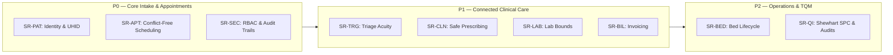

# Stakeholder Analysis & Requirements Traceability Matrix (RTM)
**Course:** BBAT104 — Fundamentals of Total Quality Management  
**Project:** Hospital Management System (HMS) — TQM-Driven Healthcare Informatics  
**Student:** Ajay Bora | **Roll No:** 2410302008 | **Branch:** CSE — Section B  
**Academic Session:** 2026–27  
**Official Guideline Identifier:** `BBAT104_TQM_2410302008`  

---

## 1. Introduction & Methodology

A foundational principle of Total Quality Management (TQM) in software engineering is that **every line of code and database schema must trace directly to a verified customer need**, and conversely, every stakeholder requirement must be verified by automated objective evidence. 

In strict adherence to **Section 7 and Section 8 of the Base Project Guideline**, this document establishes:
1. **The Comprehensive 10-Role Stakeholder Register:** Mapping the complete socio-technical ecosystem of the hospital.
2. **The Software Requirements Specification (SRS):** Formulated as atomic, testable, numbered statements (`SR-XXX-NNN`).
3. **The 6-Way Requirements Traceability Matrix (RTM):** Explicitly linking:
   $$\text{Stakeholder Need} \longleftrightarrow \text{SRS Requirement} \longleftrightarrow \text{Process Step} \longleftrightarrow \text{Database Object} \longleftrightarrow \text{UI Component} \longleftrightarrow \text{Automated Test Case}$$

---

## 2. Comprehensive 10-Role Stakeholder Register

| # | Stakeholder Role | Primary Operational Need / Problem Addressed | Critical Information Required | System Interaction Touchpoint | Success Measure & KPI |
|:---:|---|---|---|---|---|
| **1** | **Patient** | Minimized waiting time, transparent billing, and zero repeat registrations. | Doctor availability, appointment token, itemized bill, diagnosis timeline. | Patient Intake Screen / Reception Desk / Patient 360° Portal | Waiting time < 15 mins; Zero billing disputes |
| **2** | **Receptionist / Front Desk** | Fast, error-free intake; prevention of duplicate patient charts. | Master patient index, current phone number, doctor specialty roster. | Patients Tab / Appointments Tab / Dynamic Autocomplete Search | Registration cycle time < 90 secs; 0% duplicate UHIDs |
| **3** | **Attending Doctor / Clinician** | Immediate access to historical clinical context, vitals, and safe prescribing. | Longitudinal encounter history, physiological vitals, recorded allergies, lab reports. | Doctor Dashboard / Patient 360° View / Prescription Module | Zero Adverse Drug Reactions (ADR); Consultation cycle time tracking |
| **4** | **Triage & Ward Nurse** | Rapid acuity sorting; clear visibility of vital thresholds and doctor orders. | Patient blood pressure, pulse, SpO2, temperature, assigned bed status. | Emergency Triage Queue / Vitals Entry Dialog | Triage classification time < 60 secs; Zero missed Code Red alerts |
| **5** | **Billing Officer / Cashier** | Automated tariff calculations, transparent receipts, and zero financial leakage. | Room days, doctor consultation charges, dispensed pharmacy items, payment method. | Billing & Invoicing Module / Printable HTML Tax Invoices | Billing error rate = 0.0%; Instant reconciliation |
| **6** | **Laboratory Technician** | Traceable test requisitions, unambiguous specimen tracking, and critical flags. | Test name, clinical category, patient ID, biological reference intervals. | Diagnostic Lab Diagnostics Tab / Result Verification View | Lab turnaround time (TAT) < 4 hours; 100% abnormal flags highlighted |
| **7** | **Bed / Ward Manager** | Real-time bed visibility, instant sanitization tracking, and zero double-allocations. | Ward type, room number, occupancy state (`Available`, `Occupied`, `Cleaning`). | Ward & Bed Management Grid / Inpatient Admissions Tab | Bed turnaround time < 30 mins; Zero double-occupancies |
| **8** | **Hospital Quality Manager** | Objective, continuous evidence of operational stability and compliance. | Daily defect logs, Shewhart control limits, compliance audit scores, FMEA RPN. | Defect Checksheet / SQC Analytics / NABH Quality Audit Checklist | Process Capability $C_p > 1.33$; DPMO < 3,400 (4.5+ Sigma) |
| **9** | **Medical Superintendent / Hospital Manager** | High-level operational throughput, resource bottlenecks, and financial health. | Departmental patient footfall, room utilization rates, revenue collections. | Executive Summary Dashboard / Live Analytics Counters | Operational decision turnaround < 5 mins; Full bed utilization |
| **10** | **IT & Systems Administrator** | Data integrity, role enforcement, immutable auditing, and zero unrecoverable crashes. | User authentication hashes, access roles, mutation logs, snapshot backups. | Admin Console / Dual-Tier Audit Log Viewer / Automated Backup Engine | System uptime > 99.9%; 100% audit trail coverage |

---

## 3. Formal Software Requirements Specification (SRS)

Requirements are partitioned into testable functional domains with standardized identifiers:
- `SR-PAT-xxx`: Patient Intake & Identity Management
- `SR-APT-xxx`: Doctor Scheduling & Conflict Prevention
- `SR-TRG-xxx`: Emergency Acuity & Triage Evaluation
- `SR-CLN-xxx`: Clinical Documentation & Safe Prescribing
- `SR-LAB-xxx`: Diagnostic Investigations & Reference Bounds
- `SR-BIL-xxx`: Billing, Tariffs & Transparent Invoicing
- `SR-BED-xxx`: Inpatient Ward & Bed Lifecycle Management
- `SR-QI-xxx`: Quality Engineering, SPC & Compliance Audits
- `SR-SEC-xxx`: Security, Authentication & Auditability

### 3.1 Requirements Specification Table

| SRS ID | Requirement Statement | Priority | Verification Method |
|---|---|:---:|---|
| **SR-PAT-001** | The system shall generate a permanent, non-reusable Unique Hospital Identifier (`UHID-2026-XXXXX`) for every newly registered patient. | P0 | Automated Test |
| **SR-PAT-002** | The system shall enforce telephone formatting (`+91-XXXXX-XXXXX`) via real-time keystroke input masking, rejecting non-digit characters and capping at 10 digits. | P0 | Automated Test + GUI |
| **SR-PAT-003** | The system shall restrict categorical demographic fields (Gender, Blood Group) strictly to standardized medical enumerations. | P0 | Automated Test |
| **SR-PAT-004** | The system shall provide real-time substring auto-complete search across existing patient records to prevent duplicate patient charts. | P0 | Automated Test + REST |
| **SR-APT-001** | The system shall allow appointment scheduling only for valid doctor schedules and standard 30-minute time intervals. | P0 | Automated Test |
| **SR-APT-002** | The system shall execute pre-flight schedule conflict checks and reject overlapping bookings for the same doctor with HTTP 409 Conflict. | P0 | Automated Test |
| **SR-TRG-001** | The system shall validate physiological vital signs (BP, Pulse, Temp, SpO2) against bounded medical limits upon entry. | P1 | Automated Test |
| **SR-TRG-002** | The system shall evaluate vital signs and automatically sort patients into an Emergency Queue prioritized by Code Red, Yellow, and Green. | P1 | Automated Test |
| **SR-CLN-001** | The system shall assemble a longitudinal Patient 360° timeline aggregating registration, vitals, consultations, lab tests, and billing events. | P1 | Automated Test |
| **SR-CLN-002** | The system shall record documented patient drug allergies and block prescriptions containing contraindicated pharmaceutical classes. | P1 | Automated Test |
| **SR-CLN-003** | The system shall validate pharmaceutical batch numbers and expiry dates, blocking dispensing or prescription of expired medicine. | P1 | Automated Test |
| **SR-LAB-001** | The system shall support diagnostic lab test ordering across standardized laboratory categories. | P1 | Automated Test |
| **SR-LAB-002** | The system shall compare recorded quantitative lab results against biological reference ranges and compute an abnormal flag ($0$ or $1$). | P1 | Automated Test |
| **SR-BIL-001** | The system shall automatically compute total bill amounts ($Room + Consult + Meds = Total$) and block negative charge entries. | P0 | Automated Test |
| **SR-BIL-002** | The system shall generate print-ready, itemized medical tax invoices and discharge financial summaries. | P1 | Automated Test |
| **SR-BED-001** | The system shall enforce unique room numbers and maintain real-time occupancy state transitions (`Available` $\rightarrow$ `Occupied` $\rightarrow$ `Cleaning`). | P1 | Automated Test |
| **SR-BED-002** | The system shall automatically clear room assignments and toggle room status back to `Available` upon patient discharge or deletion. | P1 | Automated Test |
| **SR-QI-001** | The system shall record administrative and operational software defects into a structured checksheet feeding Pareto 80/20 analysis. | P0 | Automated Test |
| **SR-QI-002** | The system shall compute Shewhart Statistical Process Control (SPC) c-chart limits (CL, UCL, LCL) to verify process stabilization. | P1 | Automated Test |
| **SR-QI-003** | The system shall compute live Six Sigma Defect Per Million Opportunities (DPMO) and process sigma capability ratings. | P1 | Automated Test |
| **SR-QI-004** | The system shall provide an NABH & ISO 9001 departmental compliance inspection checklist with percentage scoring. | P2 | Automated Test |
| **SR-SEC-001** | The system shall enforce Role-Based Access Control (Admin, Doctor, Receptionist) with secure password hashing (SHA-256). | P0 | Automated Test |
| **SR-SEC-002** | The system shall maintain an immutable, dual-tier audit log capturing every INSERT, UPDATE, and DELETE across SQLite and CSV trails. | P0 | Automated Test |
| **SR-SEC-003** | The system shall require explicit, two-step confirmation modals before executing any database UPDATE or DELETE mutation. | P0 | GUI / DOM Test |

---

