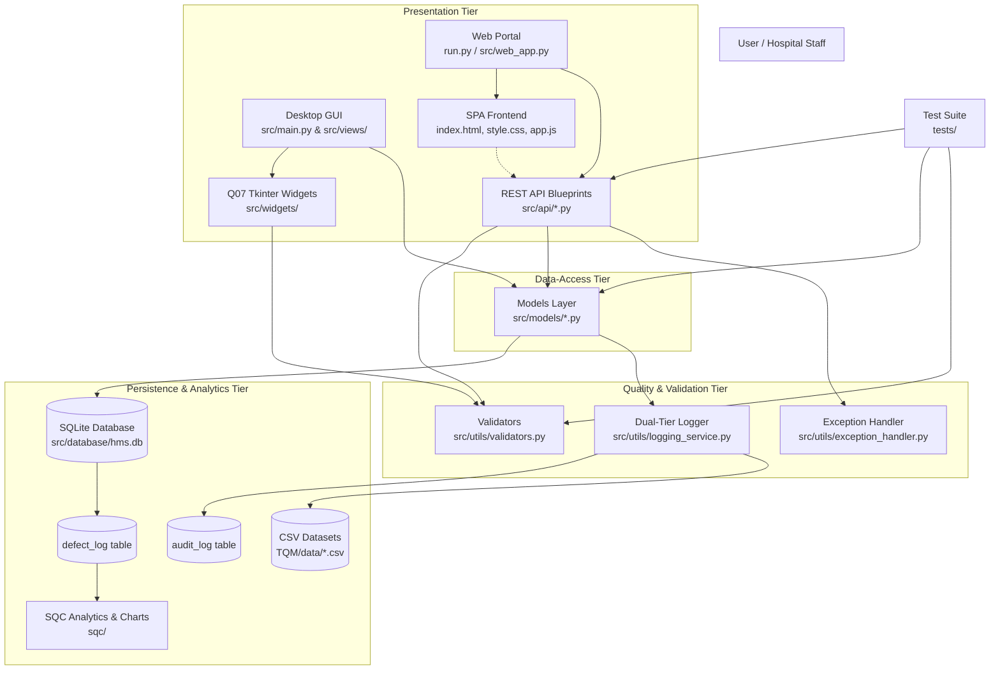

# System Architecture

## Overview

The Hospital Management System is built with a dual-presentation, multi-tier architecture designed around **Total Quality Management (TQM)** principles and **Quality Goal Q07 (Improve Data Accuracy)**:

1. **Presentation Tier:**
   - **Modern Web Application Portal:** Flask backend (`run.py`, `src/web_app.py`) serving an executive single-page application (`templates/index.html`, `static/css/style.css`, `static/js/app.js`) backed by modular REST API Blueprints (`src/api/*.py`).
   - **Native Desktop GUI:** Tkinter multi-tab interface (`src/main.py`, `src/views/*.py`) featuring custom Poka-Yoke accuracy widgets (`src/widgets/*.py`).
2. **Quality & Validation Layer:** Shared validation routines (`src/utils/validators.py`), global exception handling (`exception_handler.py`), and dual-tier audit logging (`logging_service.py`).
3. **Data-Access Models Layer:** Pure, framework-agnostic SQL data access functions (`src/models/*.py`).
4. **Database & Storage Layer:** Relational SQLite storage (`src/database/hms.db`) with foreign-key integrity constraints and immutable audit tables, supplemented by CSV audit datasets (`TQM/data/*.csv`).

Strict separation of concerns is maintained throughout: models never import UI frameworks, and views never run raw SQL queries.

---

## High-Level Layer Diagram



---

## Institutional Patient Identifier (UHID) & State Machine Integrity

The system adheres strictly to NABH and ABDM guidelines by decoupling internal patient identification from national government identities:
- **UHID (Unique Hospital Identifier):** Standardized format `UHID-2026-XXXXX` enforced via `src/models/patient.py` and `src/config.py`.
- **Finite State Machines:** Explicit lifecycles governed by `APPT_STATUS`, `ROOM_STATUS`, and `LAB_ORDER_STATUS`.

## Q07 Accuracy Control Flow

```text
User Action (e.g. Patient Registration)
    ↓
1. Phone Input Masking
    • Desktop: PhoneMaskEntry enforces +91-XXXXX-XXXXX, strips non-digits
    • Web: Client-side regex formatter in app.js prevents invalid input patterns
    ↓
2. Standardized Dropdown Selection
    • Desktop: ttk.Combobox state="readonly" constrained to config.py
    • Web: HTML <select> validated server-side against config.py sets
    ↓
3. Auto-Complete Duplicate Prevention
    • Desktop: AutocompleteEntry queries patient.name_candidates(prefix)
    • Web: Debounced REST lookup (/api/patients/search) surfaces existing charts
    ↓
4. Business Rule Validation (validators.py)
    • is_valid_date(), is_valid_time(), not_empty(), is_valid_phone_digits()
    ↓
5. Explicit Confirmation Modals
    • Desktop: confirm_delete() / confirm_update() dialogs
    • Web: Accessible DOM modals verifying action before execution
    ↓
6. Atomic Transaction & Model Execution (models/*.py)
    • SQL INSERT / UPDATE / DELETE with parameter binding
    • Atomic dual-tier audit logging executed in same transaction
    ↓
7. Audit Log Trail & Checksheet
    • Immutable records written to audit_log table and TQM CSV datasets
```

---

## File-by-File Responsibilities

### Entry Points & Application Routers

| File | Role |
|---|---|
| `run.py` | Main web server launcher; binds port (default 5001), auto-seeds initial data, and opens the web portal |
| `src/web_app.py` | Flask factory; registers 9 REST API blueprints, configures error handling, static asset routes, and SPA template serving |
| `src/main.py` | Desktop GUI entry point; builds `HMSApp(tk.Tk)`, wires all 10 tabbed views, manages notebook lifecycle |
| `src/config.py` | Central configuration and single source of truth for categorical dropdown sets (`GENDERS`, `BLOOD_GROUPS`, `DEPARTMENTS`, `ROOM_TYPES`, etc.) |

### Web Portal Presentation & REST APIs

| File | Role |
|---|---|
| `src/templates/index.html` | Semantic single-page application layout with sidebar navigation, modal containers, and responsive panels |
| `src/static/css/style.css` | Comprehensive design system featuring responsive typography, color tokens, and modal styling |
| `src/static/js/app.js` | Frontend controller; implements real-time phone masking, search autocompletion, dynamic table rendering, and REST client |
| `src/api/patients.py` | REST endpoints for patient registration, search autocompletion, updating, and room assignment |
| `src/api/doctors.py` | REST endpoints for doctor directory and department queries |
| `src/api/appointments.py` | REST endpoints for scheduling, doctor/patient linkage, and status tracking |
| `src/api/rooms.py` | REST endpoints for room occupancy, ward tariffs, and bed clearance |
| `src/api/staff.py` | REST endpoints for staff duty roster and shift assignments |
| `src/api/medicines.py` | REST endpoints for pharmacy inventory and low-stock threshold queries |
| `src/api/bills.py` | REST endpoints for itemized patient billing, auto-calculated totals, and payments |
| `src/api/audit.py` | REST endpoints for querying immutable audit trails and filtering logs |
| `src/api/dashboard.py` | REST endpoints for live executive KPI counter metrics |
| `src/api/lab_tests.py` | REST endpoints for diagnostic pathology and radiology orders with biological reference checks |
| `src/api/triage.py` | REST endpoints for emergency triage queue and priority evaluation |
| `src/api/purchase_orders.py` | REST endpoints for automated pharmacy low-stock purchase orders |
| `src/api/quality_audit.py` | REST endpoints for NABH/ISO quality checklists and compliance scoring |
| `src/api/helpers.py` | Helper functions for JSON formatting, standard responses, and validation error wrappers |

### Shared Quality & Utility Services

| File | Role |
|---|---|
| `src/utils/validators.py` | Reusable validation methods: date formats, 24-hr time formats, phone digit length, mandatory field presence |
| `src/utils/logging_service.py` | Dual-tier logging service writing audit events and error reports across SQLite and `TQM/data/*.csv` |
| `src/utils/exception_handler.py` | Centralized exception handling, logging uncaught errors and generating user-friendly error dialogs/responses |
| `src/utils/report_generator.py` | Printable HTML/PDF formatting for medical tax invoices and inpatient discharge summaries |
| `src/utils/spc_service.py` | Statistical Process Control calculation engine for Shewhart control chart parameters |
| `src/utils/sigma_calculator.py` | TQM Six Sigma calculator for DPU, DPO, DPMO, and process sigma capability |
| `src/views/login_dialog.py` | Desktop GUI authentication dialog with 1-click Quick Login and Guest Demo bypass |

### Database Layer

| File | Role |
|---|---|
| `src/database/db_manager.py` | Connection factory with `sqlite3.Row` and foreign key enforcement; manages `SCHEMA` definitions for 9 tables; atomic `log_audit()` routine |

### Q07 Widget Layer

| File | Q07 Feature | Mechanism |
|---|---|---|
| `src/widgets/phone_mask_entry.py` | Feature 1 — Input Masking | Subclasses `ttk.Entry`; `var.trace_add("write")` triggers `_format()` on every keystroke; `re.sub(r"\D","")` strips non-digits; auto-inserts `+91-` prefix and hyphen after 5th digit |
| `src/widgets/autocomplete_entry.py` | Feature 3 — Auto-Complete | Subclasses `ttk.Entry`; calls injected `fetch_candidates(prefix)` callable on each write trace; creates a floating `tk.Listbox` below the field; fires `on_select(value)` callback on pick |
| `src/widgets/confirm_dialog.py` | Feature 4 — Confirmation Modals | Three functions — `confirm()`, `confirm_delete()`, `confirm_update()` — all wrapping `messagebox.askyesno()`; returns `bool`; every view checks the return before proceeding |

### Validation Layer

| File | Role |
|---|---|
| `src/utils/validators.py` | `is_valid_date(v)` — regex `^\d{4}-\d{2}-\d{2}$`; `is_valid_time(v)` — regex `^([01]\d|2[0-3]):[0-5]\d$`; `is_valid_phone_digits(d)` — `len == 10`; `not_empty(v)` — truthy strip; `in_fixed_set(v, allowed)` — membership check |

### Models Layer (Data-Access)

Each model file contains only SQL functions — no Tkinter imports.

| File | Tables | Key Functions |
|---|---|---|
| `src/models/patient.py` | `patients` | `list_all(filter)`, `name_candidates(prefix)`, `get_id_by_name(name)`, `add(...)`, `update(...)`, `delete(id)` |
| `src/models/doctor.py` | `doctors` | `list_all()`, `choices_map()` → `{label: id}` dict for Appointments dropdown, `add()`, `update()`, `delete()` |
| `src/models/appointment.py` | `appointments` | `list_all()` with JOIN on `patients` + `doctors`, `add()`, `update()`, `delete()` |
| `src/models/room.py` | `rooms` | `list_all()`, `choices_map(only_available)`, `add()`, `update()`, `delete()` |
| `src/models/staff.py` | `staff` | `list_all()`, `add()`, `update()`, `delete()` |
| `src/models/medicine.py` | `medicines` | `list_all()`, `low_stock()` — returns items where `stock_qty <= reorder_level`, `add()`, `update()`, `delete()` |
| `src/models/bill.py` | `bills` | `list_all()` with JOIN on `patients`, `add()` — auto-calculates `total = float(room) + float(consult) + float(medicine)`, `update_status()`, `delete()` |
| `src/models/audit.py` | `audit_log`, `defect_log` | `list_audit(limit)`, `list_defects()`, `add_defect(category, desc, severity)`, `defect_counts_by_category()` → dict fed to Pareto chart |

### Views Layer (UI Tabs)

Each view imports its model, relevant widgets, and validators — never raw SQL.

| File | Tab Name | Notable Q07 Usage |
|---|---|---|
| `src/views/dashboard_view.py` | Dashboard | Live KPI counts via direct model calls; Refresh button |
| `src/views/patients_view.py` | Patients | `PhoneMaskEntry`, `Combobox(GENDERS, BLOOD_GROUPS)`, `AutocompleteEntry`, `confirm_delete/update` |
| `src/views/doctors_view.py` | Doctors | `PhoneMaskEntry`, `Combobox(DEPARTMENTS)`, `confirm_delete/update` |
| `src/views/appointments_view.py` | Appointments | Patient `AutocompleteEntry`, Doctor `Combobox`, Status `Combobox(APPT_STATUS)`, `confirm_delete/update` |
| `src/views/rooms_view.py` | Rooms / Wards | `Combobox(ROOM_TYPES, ROOM_STATUS)`, `confirm_delete/update` |
| `src/views/staff_view.py` | Staff | `PhoneMaskEntry`, `Combobox(STAFF_ROLES, SHIFTS)`, `confirm_delete/update` |
| `src/views/medicines_view.py` | Pharmacy | `Combobox(MEDICINE_CATEGORIES)`, low-stock highlight, `confirm_delete/update` |
| `src/views/billing_view.py` | Billing | Patient `AutocompleteEntry`, `Combobox(PAYMENT_METHODS, PAYMENT_STATUS)`, auto-total, `confirm_delete` |
| `src/views/audit_view.py` | Audit Log | Read-only `Treeview` of `audit_log`; refreshed on tab switch |
| `src/views/defects_view.py` | Defect Checksheet | `Combobox(DEFECT_CATEGORIES, DEFECT_SEVERITY)`, feeds `sqc/pareto_chart.py` |

### Database Schema

9 tables — all enforced through `db_manager.SCHEMA` (run once at startup via `init_db()`):

```
patients     — patient_id PK, full_name, gender CHECK, dob, blood_group CHECK,
               phone, address, room_id FK→rooms, created_at, updated_at
doctors      — doctor_id PK, full_name, department, phone, created_at
appointments — appointment_id PK, patient_id FK→patients CASCADE,
               doctor_id FK→doctors CASCADE, appt_date, appt_time,
               status DEFAULT 'Scheduled', notes, created_at
rooms        — room_id PK, room_number UNIQUE, room_type, status, rate_per_day
staff        — staff_id PK, full_name, role, shift, phone, created_at
medicines    — medicine_id PK, name, category, stock_qty, unit_price, reorder_level
bills        — bill_id PK, patient_id FK→patients CASCADE, room_charges,
               consultation_charges, medicine_charges, total_amount,
               payment_method, payment_status, created_at
audit_log    — log_id PK, table_name, record_id, action CHECK(INSERT/UPDATE/DELETE),
               details, performed_by, timestamp
defect_log   — defect_id PK, category, description, severity, status, logged_at
```

### SQC Scripts

| File | Purpose |
|---|---|
| `sqc/pareto_chart.py` | Calls `audit.defect_counts_by_category()`, sorts by frequency, plots bars + cumulative % line, saves `sqc/pareto_chart.png` |
| `sqc/fishbone_diagram.py` | Draws a 4-branch Ishikawa diagram (People, Process, Software Code, Infrastructure) using Matplotlib patches, saves `sqc/fishbone_diagram.png` |
| `docs/build_fmea.py` | Generates `docs/FMEA_RiskAudit.xlsx` using openpyxl with formula-driven RPN columns |

---

## Design Rules (Separation of Concerns)

1. **Models never import Tkinter.** All SQL logic lives in `src/models/` only.
2. **Views never run raw SQL.** All data access goes through a model function.
3. **Widgets are written once.** `PhoneMaskEntry`, `AutocompleteEntry`, and `confirm_dialog` are in `src/widgets/` and imported wherever needed — not duplicated per screen.
4. **Dropdowns are defined once.** All fixed lists live in `src/config.py`. Adding a new department means editing one line in one file.
5. **`log_audit()` is called inside the model, not the view.** This guarantees the audit trail cannot be bypassed by a view that forgets to call it.
